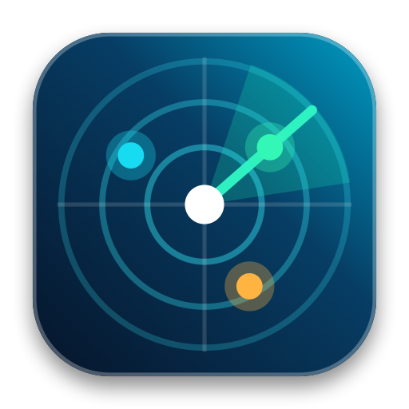

<p align="center">
  
</p>

<h1 align="center">PortRadar</h1>

<p align="center">
  <strong>Menu bar localhost & dev port manager for macOS — 100% free, open-source, native Swift.</strong>
</p>

<p align="center">
  <a href="https://github.com/joeystdio/PortRadar/releases/latest/download/PortRadar.dmg">
    
  </a>
  <a href="https://github.com/joeystdio/PortRadar/releases/latest">
    
  </a>
  
  <a href="https://buymeacoffee.com/joeystdio">
    
  </a>
</p>

---

## ✨ Features

- **📡 Live Dev Port Radar**: Instantly see every listening TCP port on your Mac (`:3000`, `:5173`, `:8080`, `:5000`, `:5432`, `:6379`) right from your menu bar, with a live active dev-server counter badge.
- **⚡ 1-Click Kill (`SIGTERM` / `SIGKILL -9`)**: Never type `lsof -i :3000` or `kill -9` again when you hit `EADDRINUSE: address already in use`. Kill any stuck port in a single click.
- **🧠 Smart Framework & Stack Detection**: Automatically tags **Next.js**, **Vite**, **Angular**, **Node.js**, **Bun**, **.NET / Kestrel**, **FastAPI / Python**, **Go**, **Rust**, **Docker / OrbStack**, **PostgreSQL**, **Redis**, **MySQL**, **MongoDB**, and **Ollama** — along with live **RAM (MB)**, **CPU %**, and **PID** badges.
- **📌 Pinned Watchlist Bar**: Pin your favorite ports (`:3000`, `:5173`, `:8080`, `:5000`, `:5432`, `:6379`) to the top watchlist bar with live green/grey status indicators and instant 1-click Open or Kill actions.
- **🌐 1-Click Open & Copy**: Open `http://localhost:PORT` directly in your browser or copy the URL to your clipboard.
- **⌨️ Global Shortcut (`⌃⌘P`)**: Summon PortRadar from anywhere in macOS with **`⌃⌘P`**.

---

## 📦 Installation

### Option 1: Homebrew (Recommended)
```bash
brew tap joeystdio/tap
brew install --cask portradar
```

### Option 2: Direct Download (`.dmg`)
1. Download [**`PortRadar.dmg`**](https://github.com/joeystdio/PortRadar/releases/latest/download/PortRadar.dmg) from the [latest release](https://github.com/joeystdio/PortRadar/releases/latest).
2. Open `PortRadar.dmg` and drag **PortRadar.app** into your **Applications** folder.

> **Note for First Launch**:
> If macOS Gatekeeper shows a warning on first launch, right-click `PortRadar.app` → **Open**, or run:
> ```bash
> xattr -cr /Applications/PortRadar.app
> ```

---

## 🛠️ Building from Source

Requires macOS 14.0+ and Swift 5.10+ / Xcode 15+:

```bash
git clone https://github.com/joeystdio/PortRadar.git
cd PortRadar
./release_dmg.sh
```

---

## ☕ Support & Buy Me a Coffee

PortRadar is 100% free and open-source. If it saves you time debugging stuck ports, consider buying me a coffee!

<p align="left">
  <a href="https://buymeacoffee.com/joeystdio">
    
  </a>
  <a href="https://paypal.me/joeystdio">
    
  </a>
</p>

---

## 📄 License

MIT License — completely free and open source forever.
